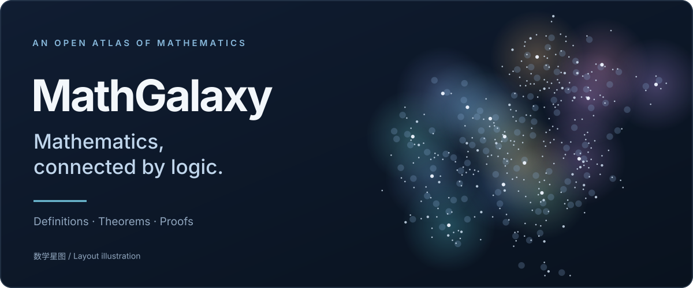
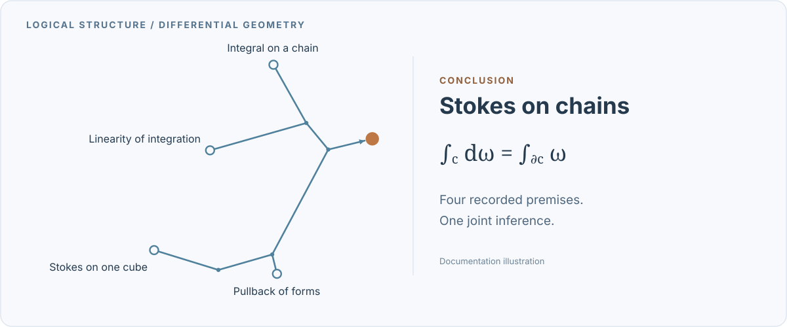

<p align="center">
  <a href="https://bingyingzizz.github.io/mathgalaxy/?v=14b71b53"></a>
</p>

<div align="center">

**An interactive atlas of definitions, theorems, and proofs.**

[**Explore MathGalaxy ↗**](https://bingyingzizz.github.io/mathgalaxy/?v=14b71b53) · [简体中文](README.zh-CN.md) · [Reading guide](reading.en.md) · [Contribute](CONTRIBUTING.md)

[](LICENSE)
[](LICENSE)


</div>

## Mathematics as a connected structure

Textbooks arrange mathematics in chapters. MathGalaxy organizes it by logical relationships: what a statement means, what is needed to prove it, and what follows from it.

Explore entire mathematical fields, zoom into individual constructions, and follow dependencies from definitions to theorems and proofs.

### Follow the logic

<a href="https://bingyingzizz.github.io/mathgalaxy/?v=14b71b53#e=imp.spivak-chain-stokes"></a>

An implication is a **joint inference**, not merely a set of independent links. The diagram shows the recorded multi-premise edge for Stokes on chains. Click it to explore the corresponding edge in the live map.

<sub>Cover and inference illustration are based on graph layout and route data. They are documentation graphics, not screenshots of the currently published application.</sub>

## Explore the atlas

| | |
| --- | --- |
| **Navigate** | Zoom from mathematical fields to clusters and individual statements. |
| **Search** | Find mathematical objects by name, alias, identifier or text. |
| **Read** | Inspect definitions, theorems, dependencies and proofs. |
| **Discover** | Explore analogies across fields, without confusing analogy with implication. |
| **Share** | Link directly to a result or export a subgraph as SVG, TikZ or JSON. |

Try [Zorn's lemma](https://bingyingzizz.github.io/mathgalaxy/?v=14b71b53#n=lem.zorn) or the [axiom of choice and well-ordering theorem](https://bingyingzizz.github.io/mathgalaxy/?v=14b71b53#e=eq.ac-wo).

## Mathematical principles

Definitions and results are organized around mathematical constructions rather than course boundaries. Substantive premises are traceable; several premises may jointly imply a result. Valuable special cases and genuinely different proofs can coexist.

MathGalaxy is an evolving mathematical knowledge base, not a formally verified proof library. Corrections and source references are welcome. Chinese is the authoritative mathematical source; English translations carry item-level review and source-version information.

## Get started

**Online:** [open the interactive atlas](https://bingyingzizz.github.io/mathgalaxy/?v=14b71b53).

**Offline:** download [`dist/mathgalaxy.html`](dist/mathgalaxy.html) using GitHub's download/raw option and open it in a browser.

**Build from source:** clone the repository, install [Bun](https://bun.sh/), and run:

```sh
bun tools/build.mjs
```

The static application requires no backend or npm installation at runtime.

## Data and development

- [Graph data](dist/graph.json) · [Content index](dist/index.md) · [Name and alias index](dist/alias.md)
- [Machine-readable retrieval guide](llms.txt) · [Notation](notation.md)
- [Contribution guide](CONTRIBUTING.md) · [Developer documentation](docs/README.md) · [Source code](src/)

Stable identifiers connect the graph, individual concept pages and structured exports. For targeted retrieval, use the index and alias table rather than loading the entire graph. Analogy edges are not logical premises.

## Contributing and license

Mathematical corrections, new proofs, translations and software improvements are welcome. Please identify the relevant node or edge and explain the mathematical or technical basis for your contribution.

Code: **MIT**. Mathematical graph content: **CC BY 4.0**. See [LICENSE](LICENSE) for attribution and citation guidance.
