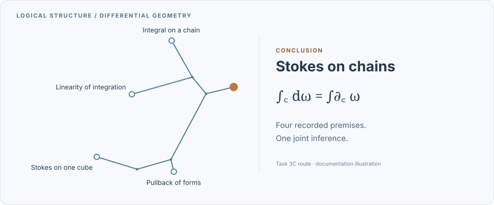

<p align="center">
  <a href="https://bingyingzizz.github.io/mathgalaxy/?v=14b71b53"></a>
</p>

<div align="center">

**一张可以交互探索的数学知识地图。**

[**进入在线星图 ↗**](https://bingyingzizz.github.io/mathgalaxy/?v=14b71b53) · [English](README.md) · [阅读指南](reading.md) · [贡献指南](CONTRIBUTING.md#中文贡献指南)

[](LICENSE)
[](LICENSE)


</div>

## 数学知识自身的结构

教材将数学组织成章节，数学星图则着重呈现知识之间的逻辑关系：一个概念如何定义，一个结论依赖哪些前提，又能由此推出什么。

从整个数学领域进入具体的数学构造，再深入到定义、定理及其证明。

### 沿着逻辑阅读数学

<a href="https://bingyingzizz.github.io/mathgalaxy/?v=14b71b53#e=imp.spivak-chain-stokes"></a>

一条多前提推导是**共同推出**，不是若干彼此独立的蕴含。图中展示的是链上的 Stokes 定理在星图中记录的多前提推导。点击图片即可进入相应连线。

<sub>封面及推导示意图取自星图的布局与路由数据，是文档插图，并非当前线上应用的截图。</sub>

## 探索星图

| | |
| --- | --- |
| **浏览** | 从数学领域逐步缩放到星团和独立数学陈述。 |
| **检索** | 按名称、别名、标识符或正文检索。 |
| **阅读** | 查阅定义、定理、依赖关系和证明。 |
| **探索** | 发现跨领域的数学类比，区分类比与逻辑推导。 |
| **分享** | 分享具体数学结果，或将子图导出为 SVG、TikZ、JSON。 |

可以从[佐恩引理](https://bingyingzizz.github.io/mathgalaxy/?v=14b71b53#n=lem.zorn)或[选择公理与良序定理的等价关系](https://bingyingzizz.github.io/mathgalaxy/?v=14b71b53#e=eq.ac-wo)开始。

## 数学组织原则

围绕数学构造而非课程划分知识。实质用到的数学前提应当可以追溯，多前提推导需要共同成立。有价值的经典特例与真正不同的有效证明可以并存。

星图仍在持续完善，目前不是经过形式化验证的证明库。欢迎指出错误并提供证明或出处。中文是数学内容的权威源，英文译文逐项记录审核与源文版本信息。

## 开始使用

**在线：** [进入交互星图](https://bingyingzizz.github.io/mathgalaxy/?v=14b71b53)。

**离线：** 下载 [`dist/mathgalaxy.html`](dist/mathgalaxy.html)，在浏览器中打开即可。

**构建：** 克隆仓库，安装 [Bun](https://bun.sh/)，运行：

```sh
bun tools/build.mjs
```

静态应用运行时不需要后端服务或 npm 安装。

## 数据与开发

- [结构化数据](dist/graph.json) · [内容目录](dist/index.md) · [名称及别名索引](dist/alias.md)
- [机器检索指南](llms.txt) · [记号规范](notation.md)
- [贡献指南](CONTRIBUTING.md) · [开发文档](docs/README.md) · [源码](src/)

稳定的节点标识符将交互星图、独立概念页面与结构化数据连接起来。建议按需从目录或别名表定位条目。类比关系不属于逻辑推导的前提。

## 贡献与许可

欢迎提交数学订正、新证明、翻译及软件改进，并说明对应的节点或连线及数学或技术依据。

代码采用 **MIT** 许可，数学图谱内容采用 **CC BY 4.0** 许可。署名与引用指引见 [LICENSE](LICENSE)。
